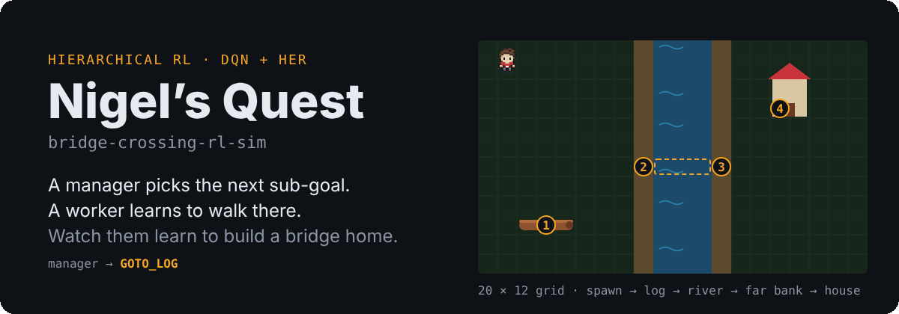
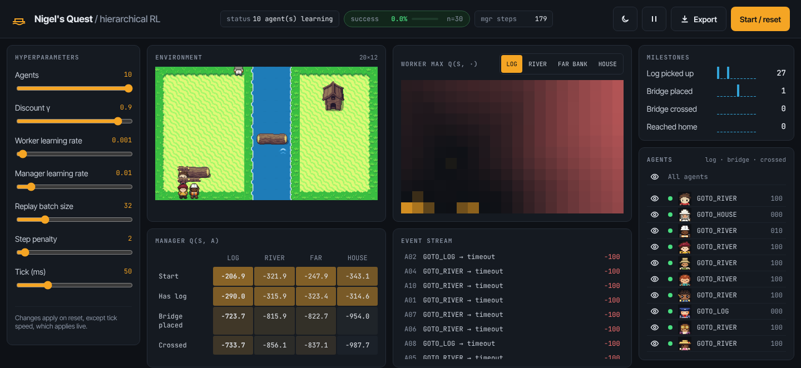
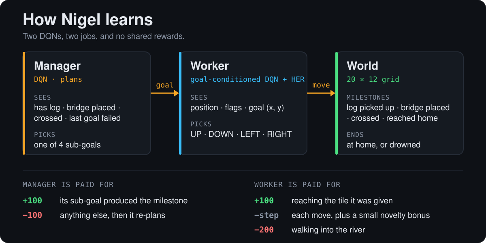

<p align="center">
  
</p>

**Bridge-Crossing-RL-Sim** is a Django app that trains a two-level reinforcement learning agent and lets you watch it learn. Each agent, starting with Nigel, has to pick up a log, lay it across a river, cross, and walk into a house. A **manager** network decides which of those steps to attempt next; a **worker** network learns how to walk to wherever the manager points. Training runs on the server and the browser shows every step live.

<p align="center">
  
</p>
<p align="center"><sub>A real 10-agent run, 90 seconds in: the log has been picked up 27 times and a bridge placed once, but nobody has crossed yet.</sub></p>

## Quick start

Python 3.13. The requirements install the CPU-only PyTorch build.

```bash
git clone https://github.com/miles-howell/bridge-crossing-rl-sim.git
cd bridge-crossing-rl-sim
python -m venv venv && source venv/bin/activate   # Windows: venv\Scripts\activate
pip install -r requirements.txt
cp .env.example .env                              # SECRET_KEY is required
python manage.py migrate                          # sessions live in SQLite
python manage.py runserver
```

Open **http://127.0.0.1:8000/simulation/** (the `/simulation/` prefix matters; `/` is a 404) and press **Start / reset**.

- `SECRET_KEY` is required; without it every page returns a server error. Any non-empty string works locally.
- `ALLOWED_HOSTS` is an optional comma-separated list and defaults to localhost only.
- A value in `.env` takes precedence over one exported in your shell.
- Skipping `migrate` lets the page load, but starting a simulation fails with `no such table: django_session`.

Run the tests with `python manage.py test`.

## What you can watch

- **Environment**: up to 10 agents (Nigel plus nine others) on the same 20 × 12 map.
- **Worker max Q(s, ·)**: a heatmap of how valuable the worker thinks each tile is, per sub-goal.
- **Manager Q(s, a)**: the manager's value for each sub-goal in each stage of the task.
- **Manager policy graph**: which sub-goal the manager prefers from each state. Feedback loops here show where it gets stuck.
- **Milestones and event stream**: how often each step of the task is reached, and why each sub-goal ended.
- **Export**: download the run report or the network weights as JSON.

Changing the sliders (agents, discount, learning rates, batch size, step penalty) takes effect on the next reset; tick speed applies live.

<details>
<summary>More screenshots: worker Q-value map and manager policy</summary>

**Worker Agent Q-value Map**


**Manager Agent Policy Distribution (Note the feedback loops hindering performance)**


</details>

## How it works

<p align="center">
  
</p>

The manager plans and the worker walks, and each is paid only for the part it controls: the manager for whether its choice of sub-goal moved the task forward, the worker for whether it reached the tile it was sent to. The [technical breakdown](#technical-breakdown) below covers the architecture, rewards and hindsight replay in full.

## Technical breakdown

This repository presents a Django-based web application designed for the interactive visualization and analysis of a Hierarchical Reinforcement Learning (HRL) model. The simulation demonstrates an artificial agent's learning process in a grid-world environment, where it must acquire the capability to construct a bridge and navigate to a designated 'home' location.


### 1. Introduction and Architectural Overview

The project implements a two-tiered HRL architecture, separating high-level strategic planning from low-level action execution. This design addresses challenges in complex, sparse-reward environments by decomposing the problem into more manageable sub-problems.

The application is structured as a Django web project, with core components organized as follows:

* **`simulation/`**: This Django app encapsulates the primary simulation logic.
    * `engine.py`: Contains the Reinforcement Learning algorithms, including the `ManagerAgent` and `WorkerAgent` implementations, the `ReplayBuffer` for experience storage, and the `SimulationWorld` representing individual agent environments.
    * `views.py`: Handles HTTP requests, serving the main simulation interface and exposing RESTful API endpoints for state retrieval and Q-value visualization.
    * `export.py`: Builds the downloadable run report and weights dump.
    * `templates/simulation/index.html`: The main frontend template for rendering the simulation.
* **`simulation_backend/`**: The root Django project, managing configurations, URL routing (`urls.py`), and settings (`settings.py`).
* **`static/`**: Hosts static assets, notably `simulation_worker.js`, which operates as a Web Worker for asynchronous simulation updates and Q-value fetching.

This architecture faces the same issue as many other hierarchical models. Training two individual, disconnected Q-value estimators can be unreliable when working towards a shared goal. A series of simple mistakes on the worker's part can result in major Q-value divergence from the optimal strategy for the manager, even if an optimal strategy has already been developed. The margin for error on either of the models' parts is extremely thin with this setup.

We address this by giving each agent a reward it fully controls, so neither is graded on the other's decisions. The manager is rewarded (+100) when an issued command results in a positive change in the environment's state (Manager issues "GOTO_LOG", environment state updates to "HAS_LOG"), and penalized (-100) when it doesn't. The worker is rewarded for reaching the coordinate it was assigned, whether or not that order was a good one. The worker's network is goal-conditioned, so it doesn't need to know *why* a coordinate matters, only how to get there; judging which coordinate is worth visiting is the manager's job. A worker mistake still costs the manager a failed subgoal, but the manager also sees whether its last subgoal failed, so it can retry instead of abandoning a correct plan.

The worker deliberately gets no share of the task milestone rewards. Each milestone fires on the same tile as the goal that asks for it, so paying it to the worker would only duplicate its goal bonus, make some goals worth far more than others inside one shared network, and credit milestones hit under a goal that didn't ask for them.

### 2. Reinforcement Learning Implementation Details

#### 2.1 Agent Architecture

* **Manager Agent (`ManagerAgent`)**: This high-level agent learns a policy for selecting abstract sub-goals. Its state space (`_get_manager_state`) is a tuple reflecting the agent's global progress, plus whether its last sub-goal failed: `(has_bridge_piece, placed_bridge, has_crossed, last_subgoal_failed)`. The action space consists of predefined sub-goals: 'GOTO_LOG', 'GOTO_RIVER', 'GOTO_FAR_BANK', and 'GOTO_HOUSE'.
* **Worker Agent (`WorkerAgent`)**: This low-level agent is responsible for executing specific sub-goals provided by the Manager. Its state space (`_get_worker_state`) includes the agent's current coordinates (`ax`, `ay`) and the Manager's three global progress flags, and its network also receives the assigned sub-goal's coordinate. The action space comprises primitive movement actions: 'UP', 'DOWN', 'LEFT', 'RIGHT'.

Both agents utilize Q-learning with an epsilon-greedy policy for action selection. Q-values are approximated by small neural networks (rather than a lookup table) and updated via bootstrapped TD-target regression against a periodically-synced target network, which stabilizes training by keeping the bootstrap target from shifting on every gradient step.

#### 2.2 Hindsight Experience Replay (HER)

The `WorkerAgent` incorporates Hindsight Experience Replay (HER) to improve sample efficiency, particularly in sparse-reward settings. When a sub-goal is attempted, both the "real" trajectory (with respect to the desired goal and dense rewards) and "imaginary" trajectories (with respect to achieved goals and sparse hindsight rewards) are stored in the `ReplayBuffer`. This allows the agent to learn from failed attempts by reinterpreting them as successes towards different, achieved goals, thereby providing more positive training signals. The imaginary copy is stored only when an attempt fails, relabeled to the tile where the attempt ended.

#### 2.3 Reward Functions

* **Worker Reward:** A step penalty (`step_penalty`) is applied at each time step, plus a small count-based novelty bonus for rarely visited tiles. Reaching the assigned sub-goal coordinate earns `WORKER_SUBGOAL_BONUS` (+100), regardless of whether that sub-goal advanced the task. Drowning earns `DROWNING_PENALTY` (-200) and ends the episode. Task milestones (picking up the log, placing the bridge, crossing, reaching home) add nothing to the worker's reward. Hindsight relabels (see 2.2) use 0 for reaching the relabeled goal and -10 per step otherwise.
* **Manager Reward:** The Manager receives a positive reward (+100) if its chosen sub-goal is achieved by the Worker within `WORKER_MAX_STEPS`, and a negative reward (-100) otherwise. A sub-goal ends as soon as any milestone fires, so a milestone reached under a goal that didn't ask for it (e.g. walking over the log while assigned `GOTO_RIVER`) counts as a failure and the Manager re-plans from the new state.

#### 2.4 Environment

The simulation operates on a `GRID_COLS` x `GRID_ROWS` grid. Key environmental features include:

* **River:** A central obstacle with a defined `RIVER_WATER_WIDTH` and `RIVER_BORDER_WIDTH`.
* **Bridge Piece:** An object that must be picked up by the agent.
* **Bridge Placement Zone:** A specific location in the river where the bridge piece can be placed.
* **House:** The ultimate target destination for the agent.

### 3. Frontend-Backend Interaction

The `simulation_worker.js` script leverages Web Workers to execute the `trainingTick` function asynchronously. This function periodically fetches the current `gameState` from a Django API endpoint (`apiStateUrl`) and posts updates to the main thread for rendering. Similarly, Q-value visualization data can be dynamically retrieved via a separate API call (`fetchAllQValues`), enabling real-time inspection of the Worker Agent's learned value function.

## Built with

- **Backend:** Python, Django, PyTorch.
- **Frontend:** plain HTML, CSS and JavaScript with a `<canvas>` renderer and a Web Worker; Inter and JetBrains Mono from Google Fonts. No frontend framework.
- **Art:** thanks to ArMM1998 on OpenGameArt.org for creating this free [spritepack](https://opengameart.org/content/zelda-like-tilesets-and-sprites), which supplies the world tiles and Nigel. The other nine agents are generated by `tools/sprites/`.

## Contributing

Contributions are welcome. Please refer to the standard GitHub flow for submitting pull requests or reporting issues. If you change a reward, update section 2.3 and the tests in `simulation/tests.py`.

## License

This project is licensed under the [Apache-2.0 License](LICENSE).
